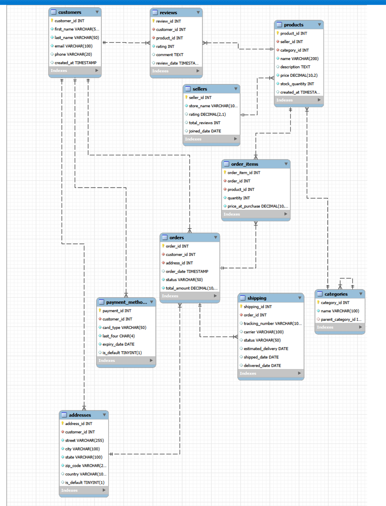

# Amazon-Style E-Commerce Platform Database

A MySQL relational database and optional Flask CRUD web app modeling the core workflows of an online marketplace: customers, addresses, payment methods, sellers, hierarchical product categories, product reviews, orders, line items, and shipping tracking.

**Status:** Completed coursework (archived reference). Built in April 2026 as a university Database Systems team project and kept public as a SQL schema and query reference. No ongoing feature development is planned.

## Schema and ER Overview

The database contains **10 tables normalized to Third Normal Form (3NF)** and **2 reporting views**.



### Key Relationships

- **Customers** (1:N) -> `addresses`, `payment_methods`, `orders`, `reviews`
- **Sellers** (1:N) -> `products`
- **Categories** (self-referencing 1:N via `parent_category_id`) -> subcategories and `products`
- **Orders** and **Products** (M:N) -> joined through `order_items` (storing `price_at_purchase` for historical pricing)
- **Orders** (1:1) -> `shipping` (enforced by `UNIQUE (order_id)`)

### Tables

| Table | Purpose | Key Constraints |
| --- | --- | --- |
| `customers` | Customer accounts | `PK (customer_id)`, `UNIQUE (email)` |
| `addresses` | Multiple shipping addresses per customer | `PK (address_id)`, `FK (customer_id)` `ON DELETE CASCADE` |
| `payment_methods` | Saved payment cards (type and last 4 digits only) | `PK (payment_id)`, `FK (customer_id)` `ON DELETE CASCADE` |
| `categories` | Hierarchical product categories | `PK (category_id)`, self-ref `FK (parent_category_id)` `ON DELETE SET NULL` |
| `sellers` | Marketplace storefronts and ratings | `PK (seller_id)`, `CHECK (rating BETWEEN 0 AND 5)` |
| `products` | Product catalog and inventory | `PK (product_id)`, `FK (seller_id)` `CASCADE`, `FK (category_id)` `RESTRICT`, `CHECK (price >= 0, stock_quantity >= 0)` |
| `reviews` | Customer product ratings and comments | `PK (review_id)`, `UNIQUE (customer_id, product_id)`, `CHECK (rating BETWEEN 1 AND 5)` |
| `orders` | Customer purchase headers | `PK (order_id)`, `FK (customer_id, address_id)` `RESTRICT`, status `CHECK` |
| `order_items` | Order line items with purchase-time price | `PK (order_item_id)`, `FK (order_id)` `CASCADE`, `FK (product_id)` `RESTRICT`, `CHECK (quantity > 0)` |
| `shipping` | Carrier, tracking number, and delivery dates | `PK (shipping_id)`, `UNIQUE FK (order_id)` `CASCADE`, status `CHECK` |

### Views

- **`vw_product_catalog`**: Joins `products`, `categories` (including parent category), `sellers`, and `reviews` to expose catalog listings with average ratings and review counts.
- **`vw_order_details`**: Joins `orders`, `customers`, `addresses`, `order_items`, `products`, and `shipping` to display complete order line items, totals, and delivery tracking.

See [Schema/schema_3nf_explanation.md](Schema/schema_3nf_explanation.md) and [Documentation/Project_Report.md](Documentation/Project_Report.md) for the full 1NF/2NF/3NF rationale and design report.

## How to Run the SQL

### Prerequisites

- **MySQL 8.0.13+** (required for `DATE DEFAULT (CURDATE())` and enforced `CHECK` constraints; tested on MySQL 8.4)
- Either the `mysql` CLI or MySQL Workbench

If you do not have a local MySQL instance, you can spin one up with Docker:

```bash
docker run --rm --name amazon-mysql \
  -e MYSQL_ROOT_PASSWORD=localdev \
  -p 3306:3306 \
  -d mysql:8.4
```

### Option 1: Single-File Setup (`Schema.sql`)

Creates the `amazon_ecommerce` database, all 10 tables, sample seed data, and both views in one step:

```bash
mysql -h 127.0.0.1 -u root -p < Schema.sql
```

In MySQL Workbench, open `Schema.sql` and run the entire script (`Ctrl+Shift+Enter`).

### Option 2: Step-by-Step Modular Scripts

Run the scripts under `Project_Implementation/` in order:

```bash
# 1. Create schema and seed sample data
mysql -h 127.0.0.1 -u root -p < Project_Implementation/Tables/01_create_tables.sql
mysql -h 127.0.0.1 -u root -p < Project_Implementation/Tables/02_insert_data.sql

# 2. Create views
mysql -h 127.0.0.1 -u root -p < Project_Implementation/Views/view_1_product_catalog.sql
mysql -h 127.0.0.1 -u root -p < Project_Implementation/Views/view_2_order_details.sql

# 3. Run read-only search, filter, and analytical report queries
mysql -h 127.0.0.1 -u root -p < Project_Implementation/Queries/04_search_filter_queries.sql
mysql -h 127.0.0.1 -u root -p < Project_Implementation/Queries/05_report_queries.sql

# 4. (Optional) Run stateful CRUD demo scripts (insert -> update -> cascade delete)
mysql -h 127.0.0.1 -u root -p < Project_Implementation/Queries/01_insert_operations.sql
mysql -h 127.0.0.1 -u root -p < Project_Implementation/Queries/02_update_operations.sql
mysql -h 127.0.0.1 -u root -p < Project_Implementation/Queries/03_delete_operations.sql
```

Quick verification queries:

```sql
USE amazon_ecommerce;
SHOW TABLES;
SELECT * FROM vw_product_catalog;
SELECT * FROM vw_order_details ORDER BY order_date DESC;
```

## Optional Flask Frontend

`frontend/` contains a lightweight Flask web app backed by the MySQL schema and views.

### Setup

```bash
python3 -m venv .venv
source .venv/bin/activate
pip install -r frontend/requirements.txt
```

Set connection environment variables (see [frontend/.env.example](frontend/.env.example)):

```bash
export MYSQL_HOST=127.0.0.1
export MYSQL_PORT=3306
export MYSQL_USER=root
export MYSQL_PASSWORD=your_mysql_password
export MYSQL_DATABASE=amazon_ecommerce
export FLASK_SECRET_KEY=change-me-local-dev

python frontend/app.py
```

Open `http://127.0.0.1:5000` in your browser.

### Routes

| Route | Method | Description |
| --- | --- | --- |
| `/` | `GET` | Home page with links to products, orders, and add-product form |
| `/products` | `GET` | Browse product catalog from `vw_product_catalog` |
| `/search_products` | `GET` | Search products by partial name (`?q=...`) |
| `/add_product` | `GET`, `POST` | Create a new product listing |
| `/edit_product/<id>` | `GET`, `POST` | Update an existing product |
| `/delete_product/<id>` | `POST` | Delete a product (handles FK constraint errors cleanly) |
| `/orders` | `GET` | View order line items and shipping status from `vw_order_details` |
| `/update_order_status/<id>` | `POST` | Update order status inline |
| `/delete_order/<id>` | `POST` | Cancel an order (`ON DELETE CASCADE` removes items and shipping) |

## Repository Layout

```text
.
├── Schema.sql                                  # All-in-one schema, seed data, and views
├── Schema/
│   ├── ER_Diagram.png                          # MySQL Workbench EER diagram
│   └── schema_3nf_explanation.md               # 1NF, 2NF, and 3NF normalization notes
├── Project_Implementation/
│   ├── Tables/
│   │   ├── 01_create_tables.sql                # DDL for all 10 tables and constraints
│   │   └── 02_insert_data.sql                  # Sample dataset
│   ├── Views/
│   │   ├── view_1_product_catalog.sql          # vw_product_catalog
│   │   └── view_2_order_details.sql            # vw_order_details
│   ├── Queries/
│   │   ├── 01_insert_operations.sql            # INSERT demos
│   │   ├── 02_update_operations.sql            # UPDATE demos
│   │   ├── 03_delete_operations.sql            # DELETE + CASCADE demos
│   │   ├── 04_search_filter_queries.sql        # Search and filter queries
│   │   └── 05_report_queries.sql               # Aggregation and multi-table reports
│   └── Screenshots/
│       └── CHECKLIST.md                        # Coursework screenshot checklist
├── Documentation/
│   └── Project_Report.md                       # Full project report
├── frontend/
│   ├── app.py                                  # Flask CRUD application
│   ├── requirements.txt                        # Python dependencies
│   ├── .env.example                            # Example database/app environment variables
│   ├── README.txt                              # Quick frontend notes
│   └── templates/                              # Jinja2 HTML templates
├── Video/
│   └── Script.txt                              # Demo presentation script
├── proposal.txt                                # Original project proposal
└── LICENSE                                     # MIT License
```

## License

Released under the [MIT License](LICENSE).
